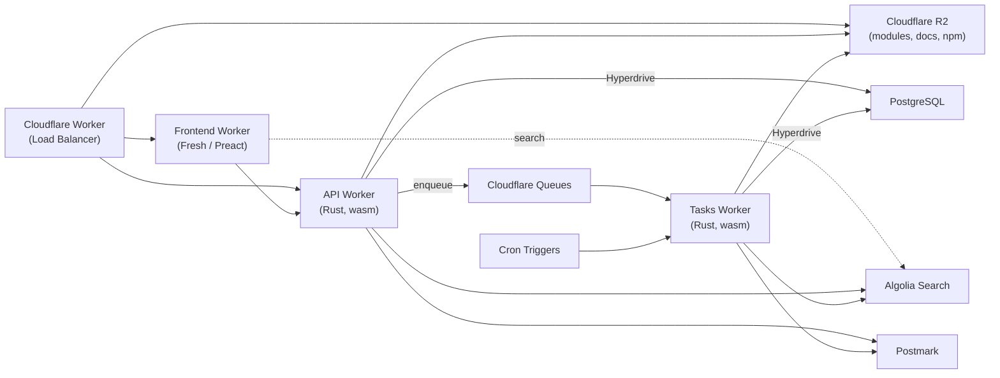

# Architecture

This document describes the high-level architecture of jsr.io, the JavaScript
registry. It is intended for both contributors looking to understand the
codebase and users curious about how the system works.

## Overview

jsr.io is composed of four main components:

1. **API** — a Rust backend that handles all business logic, deployed as a
   Cloudflare Worker, with background tasks on a second one
2. **Frontend** — a Fresh (Deno + Preact) server-rendered web application,
   bundled and deployed as a Cloudflare Worker
3. **Load Balancer** — a Cloudflare Worker that routes requests
4. **Database** — PostgreSQL for metadata storage

Module source code, generated documentation, and npm compatibility tarballs are
stored in Cloudflare R2 (S3-compatible object storage). The database is _not_
used for serving registry requests — it only stores metadata and user data.



## Request Routing

The Cloudflare Worker in `lb/` is the entry point for all traffic. It inspects
the hostname and path to route each request:

| Request                                                      | Routed to         |
| ------------------------------------------------------------ | ----------------- |
| `api.jsr.io/*`                                               | API Worker        |
| `jsr.io/api/*`                                               | API Worker        |
| `npm.jsr.io/*`                                               | R2 npm bucket     |
| `jsr.io/@scope/pkg/meta.json`, `jsr.io/@scope/pkg/version/*` | R2 modules bucket |
| Everything else on `jsr.io`                                  | Frontend Worker   |

The worker also handles CORS, security headers (including a strict Content
Security Policy for module files), bot detection for SEO, and download analytics
via the Cloudflare Analytics Engine.

## API (`api/`, `tasks/`, `shared/`)

The API is a Rust HTTP server built with Hyper and axum. It is the single source
of truth for all write operations and business logic. It is split into three
crates:

- **`api/`** — the HTTP API. Built for `wasm32-unknown-emscripten` by
  `tools/build-worker.sh` and deployed as the API Worker, which serves all API
  traffic. The load balancer and the frontend reach it through `API` service
  bindings. Each request runs on its own tokio runtime.
- **`tasks/`** — the background tasks, built and deployed the same way as the
  Tasks Worker. Its `queue` handler runs the tasks delivered by Cloudflare
  Queues (publishing, npm tarball builds, emails) and its `scheduled` handler
  the periodic ones, on Cron Triggers. Both call the task's function directly.
  Its `fetch` handler serves the `/tasks` routes to the API Worker, over the
  `TASKS` service binding, for the work the API needs done right away
  (`api/src/task_dispatch.rs`).
- **`shared/`** — what both use: the database, storage, external service
  clients, models and the Workers runtime bindings. The workers reach PostgreSQL
  through a Hyperdrive binding, R2 through bucket bindings, and other services
  through the runtime's `fetch` (`worker_js.rs`).

Natively, `cargo run` in `api/` and in `tasks/` starts each as an HTTP server,
for local development. Without queues, the API asks the tasks server
(`TASKS_URL`) to run a task where the worker would queue it.

### Directory Structure

```
api/
├── src/
│   ├── main.rs              # Entry point, server setup
│   ├── config.rs            # Environment variable configuration
│   ├── api/                 # HTTP endpoint handlers
│   │   ├── package.rs       # Package queries, versions, dependencies
│   │   ├── scope.rs         # Scope management, members, invites
│   │   ├── admin.rs         # Staff-only administration
│   │   ├── authorization.rs # OAuth token management
│   │   ├── self_user.rs     # Current user account
│   │   ├── types.rs         # Request/response types
│   │   └── errors.rs        # Error definitions
│   ├── auth/                # OAuth handlers (GitHub, GitLab)
│   ├── docs.rs              # Documentation rendering (deno_doc)
│   ├── emails/              # Email templates (Postmark)
│   ├── iam.rs               # Permissions and access control
│   ├── provenance.rs        # Package provenance verification
│   └── task_dispatch.rs     # Client for the tasks service
├── wrangler.toml            # Local `wrangler dev` configuration for the Worker
└── Cargo.toml
tasks/
├── src/
│   ├── main.rs              # Entry point: HTTP server, queue and cron handlers
│   ├── tasks.rs             # Background task handlers
│   ├── publish.rs           # Publishing pipeline
│   ├── tarball.rs           # Tarball processing
│   ├── analysis.rs          # Code analysis
│   └── npm/                 # NPM compatibility tarball generation
├── wrangler.toml
└── Cargo.toml
shared/
├── src/
│   ├── db/                  # Database queries (tokio-postgres)
│   ├── models.rs            # Database models
│   ├── ids.rs               # Type-safe identifiers
│   ├── docs.rs              # Documentation generation (deno_doc)
│   ├── external/            # External service clients (Cloudflare, Algolia)
│   ├── emails.rs            # Email delivery (Postmark)
│   ├── s3.rs                # R2/S3 storage operations
│   ├── task_queue.rs        # Rate-limited background job queue
│   ├── tracing.rs           # Logging and OpenTelemetry setup
│   ├── worker_js.rs         # Worker only: fetch, R2 and Hyperdrive bindings
│   └── worker_spans.rs      # Worker only: tracing spans as Workers trace spans
├── migrations/              # SQL migration files
└── Cargo.toml
```

### Key Responsibilities

- **Authentication**: OAuth 2.0 with GitHub and GitLab. Sessions are managed via
  JWTs and stored in the database.
- **Publishing**: Receives tarballs from `deno publish`, validates metadata and
  files, uploads to R2, generates documentation, and indexes in Algolia.
- **Package management**: CRUD operations for scopes, packages, versions, and
  members.
- **NPM compatibility**: Generates npm-compatible tarballs so JSR packages can
  be consumed by npm, yarn, pnpm, vlt, and bun.
- **Search indexing**: Pushes package metadata, symbols, and documentation to
  Algolia for full-text search.
- **Background tasks**: Long-running work (publishing, npm tarball generation)
  is queued via Cloudflare Queues and processed asynchronously.

### Key Dependencies

- **tokio-postgres / deadpool-postgres** — PostgreSQL client and connection pool
- **hyper + axum** — HTTP server and routing
- **deno_doc / deno_ast / deno_graph** — documentation generation and dependency
  analysis
- **rusty-s3** — Cloudflare R2 / S3 integration (native; the Worker uses R2
  bindings)
- **workers-rs / wasm-bindgen** — the Worker's bindings to the Workers runtime
- **tree-sitter** — syntax highlighting for source code
- **opentelemetry** — distributed tracing (native only)
- **jemalloc** — memory allocator (native only, with profiling support)

## Frontend (`frontend/`)

The frontend is a [Fresh](https://fresh.deno.dev/) application using Preact and
Tailwind CSS. It uses Fresh's
[islands architecture](https://fresh.deno.dev/docs/concepts/islands) — pages are
server-rendered by default, and only interactive components ("islands") ship
JavaScript to the browser.

In production the frontend ships as its own Cloudflare Worker:

- `frontend/build.ts` runs the Fresh vite build, mirrors the merged static tree
  (`frontend/static/`, `_fresh/{client,static}/`, and `frontend/docs/*.md` under
  `_jsr_docs/`) into `_fresh/assets/`, then bundles `frontend/server.entry.ts`
  into `_fresh/worker.js` via `deno bundle`.
- `frontend/shim/deno.ts` polyfills the subset of `Deno.*` (env, file reads,
  inspect, stat/open) needed by the Fresh server at runtime, with file reads
  forwarded to the Workers ASSETS binding.
- Static files are served by the Workers Assets binding (asset-first routing).
  Dynamic routes fall through to the worker.

Environment variables (`API_ROOT`, `FRONTEND_ROOT`, the `ALGOLIA_*` keys, etc.)
are configured as `plain_text` bindings on the worker by Terraform; no
`wrangler` interaction is needed.

### Directory Structure

```
frontend/
├── routes/                 # File-based routing
│   ├── _app.tsx            # Root layout
│   ├── _middleware.ts      # Auth and request context
│   ├── index.tsx           # Homepage
│   ├── packages.tsx        # Package search/list
│   ├── @[scope]/           # Scope pages (dynamic route)
│   ├── package/            # Package detail, docs, versions, source
│   ├── account/            # User account settings, tokens, invites
│   ├── admin/              # Staff admin dashboard
│   ├── docs/               # Registry documentation
│   └── publishing/         # Publish status tracking
├── islands/                # Interactive Preact components
│   ├── GlobalSearch.tsx    # Search bar with Algolia
│   ├── UserMenu.tsx        # User dropdown
│   ├── CopyButton.tsx      # Click-to-copy
│   └── ...
├── components/             # Server-rendered components
│   ├── doc/                # Documentation rendering
│   ├── Header.tsx
│   ├── PackageHit.tsx
│   └── ...
├── docs/                   # Markdown documentation content
├── utils/                  # Shared utilities
├── static/                 # Static assets (images, CSS)
└── deno.json
```

### Key Features

- **Server-side rendering** for fast initial loads and SEO
- **Islands architecture** — only interactive components are hydrated in the
  browser
- **Search** — global package/docs search via Algolia; in-package symbol search
  runs client-side with Orama and highlighting
- **Documentation rendering** — HTML docs generated by the API are displayed
  with breadcrumb navigation and symbol search
- **Dark mode** support via Tailwind

## Load Balancer (`lb/`)

A Cloudflare Worker that acts as the edge router. See
[Request Routing](#request-routing) above for the routing table.

Key files:

- `main.ts` — request routing logic
- `proxy.ts` — proxy to backends (service bindings for the API and frontend
  Workers) and R2
- `headers.ts` — security headers, CORS, CSP
- `bots.ts` — bot/crawler detection
- `analytics.ts` — download tracking
- `local.ts` — local development server (used by `deno task dev`)

## Database

PostgreSQL stores all metadata. Module source files are _not_ stored in the
database — they live in R2.

### Core Tables

| Table                          | Purpose                                             |
| ------------------------------ | --------------------------------------------------- |
| `users`                        | User accounts (linked to GitHub/GitLab via OAuth)   |
| `scopes`                       | Package namespaces (e.g., `@std`)                   |
| `scope_members`                | Scope ownership and membership                      |
| `packages`                     | Package metadata within a scope                     |
| `package_versions`             | Published versions with semver sorting              |
| `package_files`                | File manifest (paths, sizes, checksums) per version |
| `package_version_dependencies` | Dependency graph (jsr, npm, node, http)             |
| `publishing_tasks`             | Tracks publish jobs through their lifecycle         |
| `npm_tarballs`                 | NPM compatibility tarball records                   |
| `authorizations`               | OAuth tokens and personal access tokens             |
| `download_counts`              | JSR and npm download metrics                        |
| `audit_log`                    | Administrative action history                       |
| `email_deliveries`             | Outbox for outgoing email, delivered by a queue     |
| `tickets`                      | Support tickets, opened on the web or by email      |
| `ticket_messages`              | Messages on a ticket, in either direction           |
| `ticket_attachments`           | Files that arrived attached to an inbound email     |

Migrations are in `shared/migrations/` and applied by `registry_api setup`
(`shared/src/db/migrate.rs`), which the deploy runs from CI before the new
version serves. `cargo run` applies them at startup. Version columns use natural
collation so `1.10.0` sorts after `1.9.0`.

## Support tickets

A ticket is opened either through the web UI by a signed-in user, or by anyone
emailing the support address. Postmark delivers inbound mail to
`POST /api/hooks/postmark` (`api/src/api/hooks.rs`), authenticated with basic
auth against `POSTMARK_WEBHOOK_PASSWORD`.

An email-opened ticket has no `creator` — it belongs to `reporter_email` until
somebody claims it with the token from the auto-reply, which binds it to their
account. Every ticket email is sent under a `Message-ID` that is recorded on the
message it announces, so a reply's `In-Reply-To` / `References` headers identify
the ticket it belongs to; the `TICKET-YYYYMMDD-XXXXX` number in the subject is
the fallback for clients that drop those headers.
`ticket_messages.email_message_id` is unique, which is what makes a redelivered
webhook a no-op rather than a duplicate.

Whether a sender's address is proven is recorded per message and shown in the
UI. Postmark's own SPF check only means something for mail delivered to it
directly: support mail is forwarded from the Google Workspace inbox, so Postmark
sees the forwarder as the sender and SPF fails regardless of who wrote in. The
result Workspace recorded before forwarding survives the hop, so that is read
instead — but only from the server named by `INBOUND_TRUSTED_AUTHSERV_ID`, and
only the first such header, because each hop prepends its own and anyone can put
a forged `Authentication-Results` in the mail they send. Unset the variable and
only Postmark's own check is used.

The Postmark inbound stream's webhook URL is configured in the Postmark
dashboard, not in terraform:
`https://webhook:<POSTMARK_WEBHOOK_PASSWORD>@api.jsr.io/hooks/postmark`.

## Outgoing email

Email is never sent inline in a request. Sending is rendered at the point of the
action and written to `email_deliveries`, then handed to a queue whose messages
run `/tasks/send_email`; that handler is what talks to Postmark. A transient
Postmark failure therefore retries out of band instead of failing the request
that caused the mail — an admin ticket reply is saved once and delivered
independently, rather than returning 500 with the reply already committed.

The delivery row is committed before the queue is told about it, so a failed
hand-off leaves a row nothing would pick up. `/tasks/sweep_pending_emails`, run
every five minutes by a cron trigger, re-drives those. Re-driving is safe: a row
that has already been sent is skipped, and a redelivered task reuses the same
`Message-ID`, so even a genuine double-send is collapsed by the recipient's mail
client. A delivery that keeps failing is abandoned after eight attempts and kept
with its last error rather than deleted.

With no queue configured — local development and tests — deliveries are sent
inline instead.

## Storage (Cloudflare R2)

Five R2 buckets hold all stored files:

| Bucket               | Contents                                    |
| -------------------- | ------------------------------------------- |
| `publishing`         | Temporary tarball uploads during publish    |
| `modules`            | Published package source files and metadata |
| `docs`               | Generated HTML documentation                |
| `npm`                | NPM compatibility tarballs                  |
| `ticket-attachments` | Files attached to inbound support email     |

The `modules` bucket is served directly through the Cloudflare Worker with
strict access controls — browsers cannot navigate directly to untrusted source
files (they must use appropriate HTTP headers).

## Publishing Flow

This is the core workflow of the registry:

1. A user runs `deno publish` (or uses CI).
2. The CLI packages the source into a tarball and POSTs it to the API.
3. The API validates authorization, metadata (`deno.json`), and file contents.
4. A `publishing_task` record is created with status `pending`.
5. The task is queued to a Cloudflare Queue.
6. A background worker picks it up and:
   - Extracts files from the tarball
   - Uploads source files to the `modules` R2 bucket
   - Generates documentation via `deno_doc` and uploads to the `docs` bucket
   - Analyzes dependencies
   - Updates the database
   - Optionally generates an NPM compatibility tarball
   - Indexes the package in Algolia for search
7. The CLI polls the publishing task endpoint until it succeeds or fails.

## Search

Search is powered by [Algolia](https://www.algolia.com/) with three indexes:

- **Packages** — package name, scope, description
- **Symbols** — exported functions, types, interfaces, classes
- **Documentation** — full-text documentation content

The API pushes updates to Algolia on each publish. The frontend queries Algolia
with a search-only API key directly from the browser for instant results.

The indices, their settings (searchable attributes, faceting, ranking), and the
scoped API keys (one write key for the API, search-only keys for the frontend)
are provisioned declaratively via the Algolia Terraform provider
(`terraform/
algolia.tf`). The reindex tools only push documents and inherit
those settings through the atomic index swap.

## Infrastructure

Infrastructure is managed with Terraform across two configurations:

- `terraform/` — main infrastructure (the Workers, Hyperdrive, Queues, Cloud
  SQL, R2 buckets)
- `terraform_infra/` — CI/CD setup (GitHub Actions OIDC, Artifact Registry,
  service accounts)

### Production Deployment

- **API**: Cloudflare Worker (wasm), reaching Cloud SQL through Hyperdrive
- **API background tasks**: the Tasks Worker, from Cloudflare Queues and Cron
  Triggers.
- **Frontend**: Cloudflare Worker (Fresh build, Workers Assets binding)
- **Database**: Google Cloud SQL (PostgreSQL, high availability)
- **Job queues**: Cloudflare Queues (publishing, npm tarball builds, emails)
- **Analytics**: BigQuery (download metrics)
- **Tracing**: Workers Observability
- **Email**: Postmark
- **CDN/Edge**: Cloudflare (Worker + R2 + Cache)

## Local Development

The `deno task dev` command (implemented in `tools/dev.ts`) starts the full
stack locally:

1. **PostgreSQL** — via Docker or native install
2. **MinIO** — S3-compatible storage (stands in for R2)
3. **Jaeger** — distributed tracing UI at `http://localhost:16686`
4. **Load Balancer** — the Cloudflare Worker running locally via Deno
5. **API** — the Rust server via `cargo run`
6. **Frontend** — the Fresh dev server

Local hostnames (`jsr.test`, `api.jsr.test`, `npm.jsr.test`) are configured in
`/etc/hosts` by `deno task dev setup`.

## Tools (`tools/`)

| Script                        | Purpose                                                        |
| ----------------------------- | -------------------------------------------------------------- |
| `dev.ts`                      | Multi-process development orchestrator                         |
| `prod_proxy.ts`               | Proxy for frontend-only development against the production API |
| `algolia_packages_reindex.ts` | Reindex packages in Algolia                                    |
| `algolia_symbols_reindex.ts`  | Reindex symbols in Algolia                                     |
| `algolia_docs_reindex.ts`     | Reindex documentation in Algolia                               |
| `generate_global_symbols.ts`  | Generate Deno global type definitions                          |
| `generate_web_symbols.ts`     | Generate web API type definitions                              |
| `clone_dependency.ts`         | Clone dependencies for offline development                     |
| `migrate_package_meta.ts`     | Database migration utilities                                   |
| `db-switch.ts`                | Per-branch database management (copy, create empty, clean up)  |

## E2E Tests (`e2e/`)

End-to-end tests run against staging or production using `deno test`. They cover
authentication flows, package publishing, scope management, and API contracts.

```sh
deno task e2e:staging   # run against staging
deno task e2e:prod      # run against production
```
